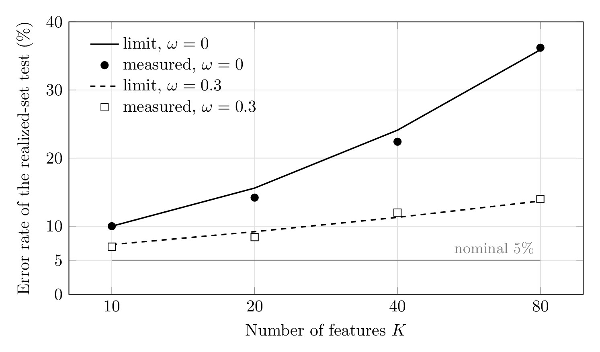

# The Observable Garden

An overfitting gate for strategies found by AI agents.

A backtest is usually the best of many attempts, so its Sharpe ratio has to be judged against
what the best of many attempts would find on pure noise. The standard correction, the deflated
Sharpe ratio, needs to know how the search was run, and for a human researcher nobody keeps that
record. An AI agent can: every strategy it evaluates, kept or discarded, can be logged. This
project asks what that log has to contain for the correction to be right, and builds a gate on
the answer.

- **The research: fixed versus adaptive candidates.** When the search is adaptive (what is tried
  next depends on what has been seen), testing against the list of strategies it tried gives the
  wrong error rate. A class of strategies declared before the search, or a log of every decision
  that can be re-run on noise, restores a valid test.
- **Quixote, the gate.** An agent searches through it; Quixote carries out and logs every move,
  then replays the search on reshuffled data to see how good a result that same search finds by
  luck, and certifies the submitted strategy or refuses it. It also audits logs from any other
  searcher.
- **Sancho**, a fixed prediction model (ridge regressions and small gradient-boosted trees over
  price, cross-asset and volume inputs) that counts as one strategy declared in advance, so the
  gate can test a non-linear strategy at the price of one trial.
- **Where it stands.** The gate keeps its error rate in every registered test; its limit is
  power. On real data it refused nearly everything, including 240 LLM agent sessions on liquid
  ETFs, and issued one certificate, on a long history of industry portfolios, whose lower bound
  held on the six years that followed. It is evidence that the gate works, not a source of
  trading signals.
- **[`research/`](research/README.md)** holds every pre-registration, run and result behind the
  claims.

## Paper

The method and results are written up in *[The Observable Garden: Fixed and adaptive
candidate sets under the DSR]([url](https://papers.ssrn.com/sol3/papers.cfm?abstract_id=7616559))* (Knaster, 2026), on SSRN.

- The paper is licensed CC BY; the code is MIT.
- [`research/NOTE_MAP.md`](research/NOTE_MAP.md) traces each claim in the paper to its
  registration and result.

## What it found

A search is adaptive when what is tried next depends on what was previously seen.

**Direction.** The direction of the error depends on how the search is built: anchoring on the
current winning strategy makes the test too lenient; on the current worst, too strict; on one
chosen uniformly at random, exactly calibrated.

**Size.** For any adaptive search, the limiting error rate of the realized-set test is the
probability that the process maximum clears the realized-set critical value, so the error is the
gap between the two nulls. For the two-stage search the gap has a closed form, and
pre-registered simulations match it.

**Remedy.** The error is removed by recording enough of the search to test it correctly. If the
candidate list was fixed before seeing the data, the returns alone suffice. If the list depends
on the data, a class of strategies declared in advance suffices, at a cost in power. A fully
re-executable record of every decision in the search restores the process null.

## How large the error is



*Error rate of the realized-set test at a nominal 5% for the two-stage, winner-anchored search on
pure noise. Lines join the limit values at K = 10, 20, 40, 80; points are the pre-registered
simulations (500 searches per cell).*

The realized-set test is the one that judges a search against the list of strategies it happened
to try.

**How the error arises.** Take a two-stage search: evaluate all K single features, take the
winner as the anchor, then evaluate every pair containing the anchor. The realized-set bootstrap
keeps the logged pairs, so every reshuffle still builds its pairs around the feature that won on
the real data. On fresh noise a different feature would typically win, so the frozen version
explores less than the search it stands in for, and its p-values come out too small.

**More features, more error.** With 80 uncorrelated features, roughly a third of searches run on
pure noise pass a test meant to pass one in twenty.

**Correlation.** When features are correlated, the best pair beats the best single feature less
often, so freezing the anchor gives up less. Correlation among trials is the limiting factor of
error, not its cause.

Simulations registered in advance matched the limit values in every cell.

## The agent sessions

With Sancho available as a single fixed candidate, the agents were then run on liquid ETFs over
2015–2024. No certificate was available on this panel: the best strategy in the declared class
was refused, and so was Sancho's. The sessions therefore could not pass, regardless of what agent
was used. In 240 independent sessions the agents converged on three strategies. Left to
themselves, they predicted a little over half of what their backtests showed. This prediction
did not change with how long or rigorously they had searched. Agents shown the gate's lower bound
stated lower and less certain expectations. Over the following 21-month holdout the three
strategies together lost slightly, which is consistent with the refusals.

## Install

```
git clone --depth 1 https://github.com/ben06kn-droid/observable-garden   # the history is large, nearly all research/
pip install -e .                  # Python 3.10 or later
pip install -e ".[sancho]"        # adds LightGBM 4.7.0, pinned: Sancho's registered results used it exactly
pip install -e ".[agent]"         # adds the Anthropic SDK, only for the LLM agent example
```

## One minute: run the gate on an example

```
quixote example
```

This audits a bundled log, a scripted searcher's moves on a small synthetic panel in
`examples/`, and prints the verdict:

```
verdict: FAIL  (the submitted rule does not clear the bar its own search sets: a search like this one finds a Sharpe this high by luck too often to tell)
submitted: -mom60_z +rev5_rank  in-sample Sharpe 0.572 after 2 moves
replay tier (the verdict): p 0.9721 at alpha 0.05, B 500
class tier (beside it): p 0.9800; the class's bar 1.888 (critical Sharpe over all 128 members)
--verbose adds the integrity check, the lower bounds and how the null was built
```

To audit a log yourself: `quixote audit examples/logs/scripted_session.json --panel
examples/data/tiny_panel.npz --class examples/class.json`.

## Your own agent, in five steps

`examples/README.md` documents each step in full.

1. **Your data as a panel.** Write an `.npz` with `returns` (T × M), `features` (T × M × K),
   `feature_names` and `periods_per_year`, and optionally costs, delay and row labels.
   `examples/make_tiny_panel.py` builds one.
2. **Declare the class before you search.** A JSON file names the features, the maximum number
   in a rule, and whether signs are free, or points to a file of supplied return streams. The
   harness hashes it before the first evaluation and writes the hash into the log.
3. **Write the agent.** It implements one method, `next_move(view) -> {"tool": ...}`. It names a
   move; the harness runs it.
   - `examples/scripted_searcher.py` is a scripted agent.
   - `examples/llm_agent.py` is an LLM adapter. It reads its API key from the environment.
4. **Run it:**
   `quixote run --agent mymodule:MyAgent --panel my.npz --class my_class.json --out log.json`.
   It prints the class's size and its bar on your panel.
5. **Audit the log:** `quixote audit log.json --panel my.npz --class my_class.json`. The audit
   refuses a log whose class or panel hash does not match the files it is given.

**Hold data back.** Before you search:
- `quixote split my.npz --holdout-from <row or date> --out split/` writes the holdout and its
  hash;
- `quixote grade log.json --insample split/insample.npz --holdout split/holdout.npz --class
  my_class.json --out split/` grades the submitted rule once. It refuses a second run on the same
  holdout.

**Why the class is fixed.** A class changed after results are seen is a search over classes, and
the gate would be pricing the wrong search. So the hash is taken before the first evaluation, and
the audit refuses a mismatch.

**Sancho's levers** are in `sancho/config.json`, documented in `sancho/CONFIG.md`. The defaults
are the registered version 2.
- `quixote sancho --panel my.npz [--config my.json] --out dir/` writes the config's hash into the
  output.
- **Sancho needs history before it scores anything.** Its first scored row is 756 (after the
  embargo, 763), so it needs a panel of a few years. On the 600-row example panel it refuses, by
  design.
- A non-default config says, once, that the registered results apply to the default only, and
  that every configuration tried on the same data is another strategy and must be declared as
  such.

## What a verdict means

| status | meaning |
|---|---|
| **PASS** | p is below α: the submitted rule beats what the search would find on noise. |
| **FAIL** | p is at or above α, and the test had the power to tell: the result is what this search finds by luck. |
| **INADMISSIBLE** | p is at or above α, and the search was too wide to certify anything: the test's power against the reference Sharpe (1.0 by default) is below the power floor (0.20). |
| **UNDECIDABLE** | the record alone cannot license a correction, for example returns logged without the search that chose them. |
| **DEGENERATE** | the test statistic broke on this menu. Do not read its p. |

- **The lower bound** (`L_0.90`) is the Sharpe the selected rule is 90% confident of exceeding,
  after the search is paid for.
- **The detection floor** is the smallest Sharpe the gate can certify for a class and a sample
  length. Look at it before you search:

  ```
  quixote power --years 10 --size 82240
  ```
  ```
  smallest Sharpe the gate can certify (the bar): 1.533
  true Sharpe needed for 80% power:                1.800
  ```

  Those are for independent members, the worst case. Correlated members act like fewer, and
  `quixote run` prints the bar measured on your panel.

## What has been validated, and what has not

- **The direction of the error** under adaptive search is a limit result. It is proved for large
  samples and one common pair score, which requires equal volatilities and correlations. With
  finite samples it is measured, not proved.
- **Other scoring rules.** Outside weighted sums of features the asymmetry is measured, but no
  size is established and nothing is proved.
- **The process bootstrap** is covered in theory for rules that depend on the ranking of Sharpe
  ratios. For correlation-based anchoring with equal correlations the argument is a sketch; with
  unequal correlations it is open.
- **The number of trials is held fixed** in the theory. The 1,500-trial grid and the
  82,240-strategy class are supported by simulation, not by the theorem.
- **Block correlation and unequal volatilities** have not been tested.
- **Stopping-rule replay**, the null Quixote certifies with, had error rates at or below nominal
  on the searchers tested. Exactness is not claimed and nothing is proved.
- **The simulation evidence** is scripted searchers and synthetic returns.
- **On real data** the gate refused on French industries 2010-2019, on Binance perpetuals and on
  liquid ETFs 2015-2024. It issued one certificate, on French industries 1926-1989 under the
  recency-weighted statistic, and that certificate's lower bound held on 1990-1995. That is
  evidence for the gate, not for a tradable signal.
- **Whatever a searcher considers without evaluating is never logged,** at any level of record.

## The research record

Pre-registrations, runs, reads and the code behind every result are in
[`research/`](research/README.md). `research/NOTE_MAP.md` maps each claim to its registration, result
and read.

[](https://doi.org/10.5281/zenodo.23332377)

## Tests

```
pytest tests -m "not slow"        # the quick target, under two minutes (CI runs it)
pytest tests research/tests       # everything; much of research/tests needs machine-local data
```

## Use of generative AI

The research question, the design of the experiments, and every decision on what was
registered, run and reported are the author's. Generative AI tools (Claude, Anthropic) were
used in drafting and editing text and in writing and reviewing code under the author's
direction; the author checked the results and takes responsibility for them. Language-model
agents are also the subject of the agent experiments.

## Licence

MIT licence. The licence covers the code; the datasets keep their own terms.
