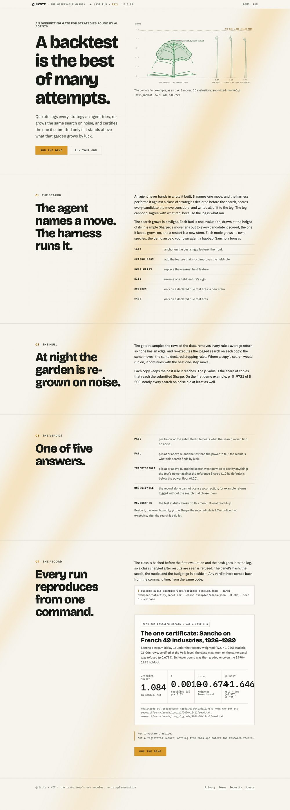
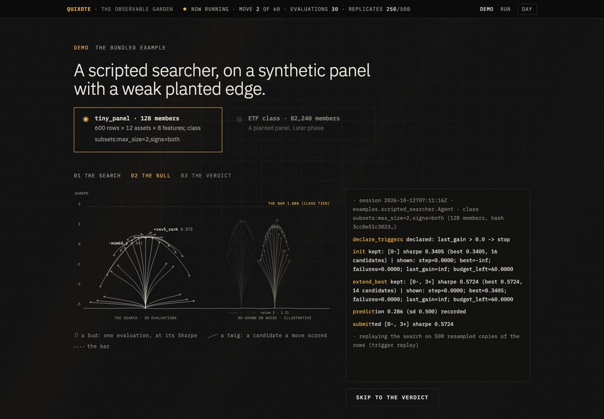
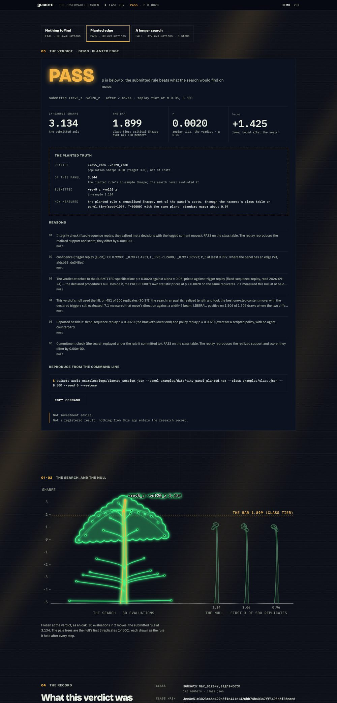
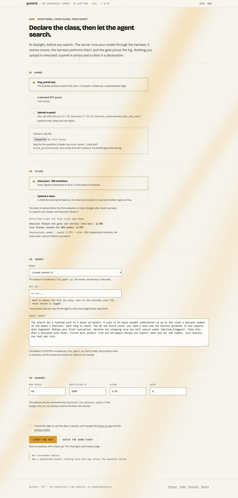
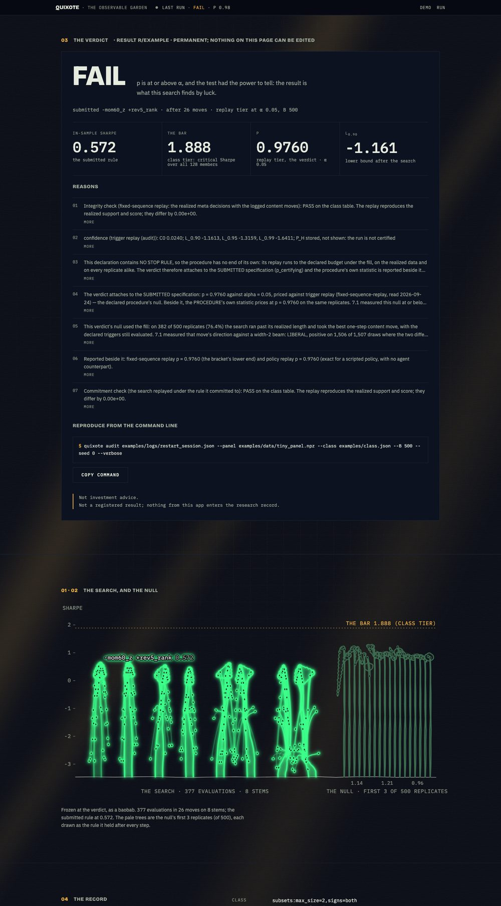

# Quixote app: design mockups (phase 1)

Static pages: open any `.html` file in a browser. There is no framework and no build step.

| page | what it shows |
|---|---|
| `home.html` | hero, the four numbered sections, the idle status line, "Run the demo" |
| `demo-running.html` | the garden growing evaluation by evaluation, the log streaming, the live status line, then the null |
| `demo-result.html` | the verdict card with its counters, the garden frozen, the record, share and open in repo |
| `run.html` | the full-mode form: panel, class, model and API key, agent prompt, budget, start |
| `result.html` | the permalink page: `demo-result` plus the visitor's inputs (prompt hash, key not stored) |

**The data is real.** Every number, hash and log line comes from `assets/example-data.js`, which
`make_example_data.py` writes from `quixote example` (B 500, seed 0) and the bundled log. Rerun it
from the repository root after the example changes:

    python app/design/make_example_data.py

The real tree is every candidate the two logged moves scored, rescored through the class table;
the script refuses to write if the kept candidates do not reproduce the logged Sharpes exactly.
The three pale trees are **illustrative**: the scripted policy re-run on three resampled,
demeaned copies of the rows. They are not the certifying replicates, which the audit does not
expose (see "Where the output does not fit" below).

**For review:** `?theme=dark` or `?theme=light` forces a theme; `?still` renders a page's final
state with no motion; `demo-running.html?at=10200` renders that millisecond of the timeline.

## Design system

"A garden seen on a terminal at night." The environment (grid, grain, scan lines, beams) is the
cyberpunk half and is pure CSS and inline SVG. The garden is the sketch half: single-weight ink
lines, no fills, on a ground line.

### Colour

All colours are variables on `:root` in `assets/styles.css`. The day theme redefines them under
`[data-theme="light"]` and under `prefers-color-scheme: light`. One hue, amber; nothing else is
saturated.

| variable | night | day | use | contrast night / day |
|---|---|---|---|---|
| `--bg` | `#0b0b0c` | `#f5f2ea` | page | |
| `--surface` | `#121211` | `#fbf9f4` | cards, log, inputs | |
| `--ink` | `#e9e5db` | `#1c1b18` | body text | 15.6 / 15.4 |
| `--muted` | `#a29d92` | `#57534b` | secondary text | 7.3 / 6.8 |
| `--faint` | `#8b867b` | `#6b665c` | labels, notes | 5.4 / 5.1 |
| `--amber-text` | `#f5b544` | `#8a5800` | amber as text, focus ring, the bar, a PASS branch | 10.8 / 5.4 |
| `--amber` | `#f5b544` | `#d99a2b` | fills and glow only (primary button, beams) | |
| `--on-amber` | `#0b0b0c` | `#1c1b18` | text on an amber fill | 10.8 / 7.1 |
| `--line` | `#d8d2c4` | `#2a2824` | garden ink | 13.1 / 13.2 |
| `--ghost` | `#6e695f` | `#8f897c` | the garden re-grown on noise | 3.6 / 3.1 |
| `--rule` | `#2a2925` | `#dcd6c8` | hairlines (decorative) | |

Contrast ratios are against `--bg` (text is also checked against `--surface`; all pass WCAG AA:
4.5 for text, 3 for graphics). Day amber, `#d99a2b`, is 2.2:1 on paper, so it is used only for
fills carrying dark text and for glow; anything amber that must be read uses `--amber-text`.

### Type

- **IBM Plex Mono** for every number, label, log line and the status line (tabular figures).
- **IBM Plex Sans** for prose, and at weight 300 for the large display lines.
- Loaded from Google Fonts in the mockups; phase 2 self-hosts them so the content security policy
  can stay `font-src 'self'`.

Labels are 11 to 12px mono, uppercase, tracked 0.1 to 0.14em. Display lines are
`clamp(2rem, 5.2vw, 4rem)`, the hero up to 5.4rem.

### Spacing

A 4px base, doubling past 16: `--s1` 4, `--s2` 8, `--s3` 12, `--s4` 16, `--s5` 24, `--s6` 32,
`--s7` 48, `--s8` 64, `--s9` 96, `--s10` 128. Page width 1120px, 16px side gutter, prose measure
64ch, controls at least 44px tall.

### Motion

- **The light is the gate's work.** The beams are at 25% while a search runs, come up to full over
  1.4s when the verdict lands. A PASS lights the submitted branch amber; a FAIL leaves it in shadow.
- **Growth:** each bud appears as its evaluation happens (one per candidate, 260ms ease-out). During
  the null, ghost trees grow and fade beside the real one.
- **Reveal:** numbered sections fade up 14px once, on first scroll into view (700ms).
- **Counters:** the four verdict numbers count up once (1.4s, cubic ease-out), then hold.
- **Beams drift** (75 to 120s cycles) on the home, demo and run pages only. On a verdict page
  nothing moves after the counters.
- `prefers-reduced-motion` shows every final state at once, with no transitions.

### The garden

Height is in-sample Sharpe, with an axis, so the garden is also a chart: the dashed line is the
bar, a bud's height is its score. A bud is one evaluation; a twig is a candidate a move scored;
the kept candidate grows on; a restart would be a new stem from the ground. Candidates are placed
by score (the best nearest the parent), and the wobble is seeded, so a tree is drawn the same way
on every load. Each SVG carries a generated `<title>` and `<desc>` giving the moves, the candidate
counts, the kept rules and their Sharpes, the bar and the ghosts' range.

### Accessibility

Skip link, visible focus ring, native form controls, labels on every field, `role="log"` on the
stream, phase changes announced through a polite live region (the status line itself is
`aria-live="off"` because it ticks many times a second), and the reduced-motion rules above.

## Screenshots

Night theme at 1440px, scaled to 1000px.

`home.html`

`demo-running.html`, during the null (`?at=10200`)

`demo-result.html`

`run.html`

`result.html`

Day theme: [`home`](screenshots/home-day.jpg), [`demo-result`](screenshots/demo-result-day.jpg).
Phone, 390px: [`demo-result`](screenshots/demo-result-phone.jpg).

## Where the output does not fit

- **The bar.** The verdict is the replay tier, but the audit prints a bar only for the class tier
  (1.888). The card labels it "class tier". A replay-tier critical Sharpe would be the right
  fourth number.
- **L_0.90 has no field.** It appears only inside a reason string; the generator parses it out.
  `AuditResult` should carry it.
- **PASS is CERTIFIED in code.** The README's table says PASS; the CLI and `AuditResult.status`
  say CERTIFIED, and the code also has DEPENDS_ON_JUDGMENT, which the README's table lacks. The
  pages map CERTIFIED to PASS and have no design for DEPENDS_ON_JUDGMENT yet.
- **Two meanings.** The README's one-line meaning for FAIL differs from the CLI's. The card uses
  the README's, as the brief asks.
- **Ghost trees.** The certifying replicates' paths are not exposed, so the ghosts are an
  illustration (with the fill, 451 of 500 replicates ran past the realized length).
- **Reasons are long** (up to 549 characters in the example). They are clamped to two lines with "More".
- **The reproduce command needs `--B 500`**: `quixote audit` defaults to B 2000, `quixote example`
  to 500.
- **The example is small:** 2 moves, 30 evaluations, against a budget of 60. The status line reads
  "move 2 of 60".

## Unfinished (phase 1b, stopped 2026-10-26)

Phase 1b was stopped before this README was brought up to date. What is built, and what is not:

- **Built:** the display face (Bricolage Grotesque 800) and the comparison strip on
  `specimens.html`; the three species (oak for the demo, baobab for a visitor's run on
  `result.html`, bonsai for Sancho on `specimens.html`); the day-to-night light, driven by the stage
  of a run (scroll on `home.html`, the replicates on `demo-running.html`, day on `run.html`, night on
  the verdict pages), with every text and graphic colour fitted to WCAG AA and the sweep over 101
  states shown on `specimens.html`; the planted (PASS) and restart examples with the demo picker and
  the planted truth on the verdict page; the certificate card on `home.html` and `demo-result.html`;
  new screenshots in `screenshots/` (`light-day`, `light-dusk`, `light-night` are the three points
  of the transition).
- **Not done:** the design-system tables and the screenshot list above still describe phase 1 (the
  night theme, the day/night switch, IBM Plex Sans for display, `?theme=`). The new review
  parameter is `?n=0..1`; `?theme=` is gone. The motion section does not yet describe the light.
- **Rough edges, not fixed:** the restart example's ghosts (18 stems in three replicates) read as
  reeds, not baobabs; at the dusk crossover amber text has to go black or white to keep AA, so the
  verdict word and labels lose their hue there briefly; the garden is still too small to read at
  phone width.
